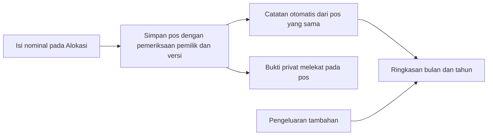

# Alokasi sebagai pembayaran atau penyerahan yang sudah terjadi

Status 16 November 2026: **rancangan, implementasi dan rilis disetujui pengguna serta terverifikasi online**. Runtime `bc59ec6833ac21d71c62b9d62a94bef6bb0f2c06`, skema 0005. Nilai lama tetap legacy dan tidak dikonversi oleh proses rilis. Acuan awal penyusunan: `f75dfc5`; backend sebelumnya `41508f5`. Tidak ada layanan, akun, dependensi, atau kunci baru.

## Masalah dan keputusan pengguna

Pengguna mengisi nominal Alokasi sesudah membayar atau menyerahkan uang. Alokasi harus langsung muncul dalam catatan dan menerima JPG/PNG opsional pada pos itu. Perubahan nominal memperbarui catatan yang sama; pengisian tidak memerlukan tombol konfirmasi pembayaran kedua. Preview disetujui; implementasi/migrasi dan rilis masih memerlukan tinjauan sesuai panduan proyek.

## Bukti dari kode

| Area | Perilaku sekarang | Dampak perubahan |
| --- | --- | --- |
| `shared/domain.ts` | Sisa dari nominal pos; pengeluaran dari tabel expenses; kiriman tersedia dari pos transfer_out | Semua angka harus melalui definisi catatan efektif yang sama agar tidak menghitung sumber dan turunannya dua kali |
| `worker/finance.ts` | Edit nominal memakai versi kolom; expenses/transfers ditulis lewat endpoint terpisah | Pertahankan CAS/idempotensi. Catatan otomatis tidak boleh membutuhkan dua penulisan keuangan yang dapat terpisah |
| `worker/finance.ts:createPeriod` | Salin bulan membawa nominal sumber | Nominal pembayaran bulan baru wajib kosong; bukti, catatan dan tanggal tidak ikut disalin |
| `worker/attachments.ts` | Bukti expense dan income memakai pemetaan tabel tetap, kuota/decode/owner | Tambah koleksi bukti pos aktual; jangan mengendurkan izin koleksi yang sudah ada |
| `migrations/0001_initial.sql` | Guard parent/owner, batas catatan, lock, revisi dan larangan hapus induk beranak | Mode baru harus mempertahankan seluruh guard dan menyediakan perlakuan eksplisit untuk catatan lama |
| `worker/reports.ts`, `shared/year-report.ts` | Preagregasi expenses, lengkap-only, total berbobot dan guard overflow | Preagregasi catatan efektif per pemilik; kiriman internal dan uang disisihkan bukan belanja eksternal |
| `scripts/neon-backup.mjs` | Format 4, daftar kolom/tabel ketat, restore tujuan kosong | Skema baru memerlukan format 5, termasuk bukti pos serta status sumber catatan |
| `data/template.json` | Terdapat pos tabungan dan transportasi pasangan di kelompok allocation | Nama pos tidak cukup menentukan bahwa uang sudah keluar keluarga; klasifikasi perlu eksplisit |

## Rekomendasi: satu sumber nominal, catatan berupa tampilan turunan

Simpan nominal aktual pada pos Alokasi yang sama. Catatan otomatis merupakan proyeksi sumber itu, bukan salinan baru pada expenses/transfers. Identitas catatan stabil, misalnya pasangan `(source='allocation', item_id)`. Proyeksi dibentuk di backend dan dipakai beranda, daftar catatan, galeri serta laporan tahun. Menampilkan catatan tidak menulis database.

Alternatif membuat expense/transfer salinan setiap kali nominal berubah tidak dipilih: menambah risiko duplikasi, sinkronisasi dua versi dan penghapusan silang. Menganggap seluruh nilai lama sebagai pengeluaran juga tidak dipilih: nilai itu mungkin sudah dicatat di expenses/transfers.

## Data dan aturan yang diusulkan

Migrasi additive 0005 menambah metadata pencatatan pada `budget_items`: mode `legacy`/`actual`, jenis aktual `external`/`internal`/`reserve`, tanggal opsional, serta versi yang diperlukan untuk koreksi metadata. Nama teknis akhir mengikuti konvensi saat implementasi; aturan berikut wajib tetap:

- Semua pos lama mulai `legacy`. Migrasi tidak mengubah nominal, jenis lama, tanggal, gambar, kredensial atau histori.
- Pos non-income baru memakai `actual`. Jenis dipilih sekali saat membuat pos: **Pembayaran**, **Kiriman pasangan**, atau **Disisihkan**. Pemilik dapat mengoreksi klasifikasi lewat tindakan eksplisit dengan versi dan ringkasan dampak hitungan; tidak ditebak dari nama. Template publik boleh membawa klasifikasi eksplisit; template privat lama perlu dipetakan/tinjau dahulu.
- Pada mode actual, jenis aktual menjadi sumber klasifikasi catatan efektif. Kind lama tetap diperlukan untuk kompatibilitas data legacy dan tidak ditulis ulang otomatis. Constraint dan helper bersama mencegah kombinasi tidak sah. Income mempertahankan alur serta buktinya sekarang.
- Nominal NULL = belum ada pembagian/pembayaran; 0 = sengaja nol, tampak sebagai catatan nol dan tidak menambah total. Jumlah positif maksimal batas nominal yang sudah berlaku.
- Enter atau keluar kolom menyimpan nominal dengan CAS yang sudah ada. Status Tercatat otomatis hanya muncul sesudah server mengonfirmasi. Retry setelah jawaban hilang membaca kembali pos yang sama, tidak membuat catatan kedua.
- Tanggal pembayaran dapat diisi/dikoreksi pada rincian pos dan wajib berada pada bulan tersebut. Jika belum diisi, tampilkan konteks bulan, jangan mengarang tanggal historis dari waktu migrasi atau tanggal 1. Timestamp simpan tetap dibedakan dari tanggal transaksi.
- Koreksi nominal/label mempertahankan identitas catatan dan bukti. Kosongkan nominal atau hapus pos aktual yang mempunyai bukti memerlukan konfirmasi pembatalan; bukti dinonaktifkan atomik dan dibersihkan lewat pola deleting. Jika tersambung ulang tidak boleh menghidupkan kembali bukti yang dibatalkan.
- Catatan otomatis dibaca dari daftar yang sama tetapi diedit melalui pos sumber. Endpoint expense/transfer manual menolak mutasi terhadap catatan turunan atau histori yang sudah digantikan proyeksi.
- Menu Catat untuk pembayaran tambahan tetap tersedia dan diberi penjelasan tidak mengulang nominal Alokasi. Tambahan merupakan baris berbeda dengan sumber `manual`, dihitung sekali, dan tidak mengubah nominal sumber. Tidak menambah pencatatan pembayaran bank atau koneksi bank.

### Penyimpanan bukti

Tabel baru `allocation_attachments` mengacu pada ID pos aktual, memakai metadata dan pola tombstone yang sama dengan koleksi bukti lama. Koleksi ini mencakup pembayaran, penyerahan ke pasangan dan uang disisihkan. Maksimal 10 JPG/PNG per pos, 5 MiB/gambar, pemeriksaan MIME/byte/decode/dimensi/checksum, kuota saat reservasi dengan lock keluarga, serta ID unik lintas ketiga koleksi. Rute backend tetap terpisah melalui pemetaan konstan; tidak menerima nama tabel dari pengguna.

Kedua akun membaca gambar, hanya pemilik mengunggah/menghapus. Pasangan penerima membaca bukti kiriman dari sumber yang sama. API tidak mengembalikan object_key; cache PWA tetap hanya antarmuka. Retire, retry, parent dihapus di tengah upload, cleanup dan backup harus mencakup koleksi baru.

## Cara menghitung

Catatan efektif mode actual berasal dari pos; mode legacy tetap berasal dari expenses/transfers yang masih aktif. Catatan manual tambahan pada pos actual dihitung sebagai pembayaran tambahan. Histori sebelum konversi tidak dihitung lagi setelah pemilik menyetujui penggantian sumbernya.

| Ringkasan | Rumus yang dipakai |
| --- | --- |
| Dana pemilik | Pemasukan sendiri + kiriman masuk efektif |
| Sudah dibayar/diserahkan pemilik | Pembayaran eksternal + kiriman keluar + disisihkan + pembayaran tambahan |
| Sisa belum dibagi pemilik | Dana pemilik − seluruh pembagian pemilik tersebut |
| Pemasukan keluarga | Pemasukan eksternal suami + istri, tanpa kiriman internal |
| Pembayaran ke luar keluarga | Pembayaran eksternal kedua pemilik + tambahan, tanpa kiriman internal/disisihkan |
| Sisa belum dibagi keluarga | Pemasukan eksternal − pembayaran eksternal − uang disisihkan |

Kiriman pasangan mengurangi bagian pengirim dan menambah bagian penerima sekali. Disisihkan mengurangi uang belum dibagi, tetapi tetap dibedakan dari belanja dan tidak membuat saldo rekening/tabungan baru. Dashboard tidak boleh menyebut sisa ini saldo bank atau klaim nilai kekayaan. Ringkasan memperlihatkan disisihkan terpisah bila ada agar pengurangan dapat dijelaskan.

Donut membagi pembagian uang yang sudah dicatat. Grafik pemasukan/pembayaran hanya memakai pembayaran eksternal efektif. Rasio tahunan tetap total nominal dibagi total pemasukan, bukan rata-rata persentase; cakupan bulan lengkap-only yang sudah disetujui dipertahankan dan dijelaskan. Nominal NULL di pos actual berarti belum diisi, bukan 0; masa depan dengan nominal kosong tidak masuk lengkap. Tidak ada fitur tutup bulan baru.

## Data lama dan konversi tanpa duplikasi

Semua data lama tetap dapat dibaca dan tidak dikonversi diam-diam. Tampilkan penanda Alur lama pada posnya serta tindakan Tinjau pencatatan. Pada peninjauan, pemilik melihat nominal pos, total catatan terkait, jumlah bukti, jenis uang dan konsekuensi sisa/rasio sebelum menyetujui:

1. Tanpa catatan terkait: pemilik mengonfirmasi bahwa nominal lama benar sudah dibayar/diserahkan, memilih klasifikasi, lalu mengaktifkan sumber actual dengan versi terkini.
2. Dengan expenses/transfers terkait: sarankan memakai total catatan aktif lama sebagai nominal actual supaya total pembayaran tidak melonjak. Pemilik boleh menentukan angka koreksi dengan konfirmasi dampaknya. Jangan menjumlahkan nilai pos dengan total catatan lama.
3. Simpan cutover pada sumber secara atomik dengan lock/CAS dan snapshot revisi catatan anak. Bila anak berubah sejak ditinjau, batalkan konversi dan tampilkan data terbaru. Histori lama beserta buktinya dipertahankan dan diberi penanda sudah terwakili Alokasi; bukan dihapus. Bukti historis tetap dapat dibuka dari rincian pos, terpisah dari kuota unggahan baru.
4. Identitas histori yang dikecualikan harus eksplisit dan tidak membungkam pengeluaran tambahan baru. Gunakan metadata pengganti sumber pada baris anak yang termasuk peninjauan, misalnya `superseded_by_item_id` dan waktu cutover; jangan mengecualikan semua anak hanya berdasarkan item_id. Guard menolak penambahan baru dengan metadata pengganti dari klien.

Membatalkan pembagian actual menonaktifkan sumber actual; histori yang pernah digantikan tidak otomatis hidup kembali. Pemulihan ke pencatatan lama memerlukan tindakan administratif yang ditinjau, bukan toggle yang dapat menggandakan total. Pembatalan dibedakan dari menghapus histori.

## Salin bulan dan perangkat lama

Salin bulan pada alur baru membawa **struktur, label, urutan dan klasifikasi** saja. Seluruh nominal, tanggal, penanda konversi dan bukti di bulan tujuan kosong; jenis actual dipakai untuk pos baru. Tidak membuat catatan pembayaran baru hanya karena menyalin bulan. Konfirmasi salin menjelaskan perubahan ini, termasuk nominal pemasukan kosong untuk mencegah klaim pemasukan yang belum terjadi.

Perubahan semantik memerlukan penanda versi protokol klien. Backend menolak penulisan keuangan dari antarmuka lama dengan pesan Perbarui aplikasi, alih-alih menyimpan rencana sebagai pembayaran tanpa diketahui pengguna. Login, logout dan ganti sandi mempertahankan kontrak. Draf yang tertahan tetap terlihat; pembaruan PWA tidak dipaksa ketika ada isian belum tersimpan. Versi baru dan lama diuji selama pergantian deployment.

## Backup, rilis dan rollback

- Tidak ada perubahan identitas, hash, sesi, tujuh secret, provider atau paket layanan.
- Backup format 5 memuat semua kolom mode/jenis/tanggal/cutover, tabel bukti baru, dan gambar siap dari sumber aktif maupun histori yang tetap dapat dibaca. Restore memverifikasi referensi/cakupan objek/checksum, hanya pada tujuan kosong dan kode/migrasi yang cocok; sesi tidak dipulihkan. Penanda sumber tidak boleh hilang sehingga histori kembali dihitung.
- Sebelum migrasi produksi wajib backup format 4 memakai kode immutable runtime 41508f5, simpan pepper terpisah. Migrasi tidak mengaktifkan konversi data lama. Sesudah rilis buat backup format 5. Format 4 lama dipulihkan pada tujuan terisolasi memakai kode yang cocok, kemudian diupgrade.
- Rollback aplikasi ke backend tanpa mode/cutover tidak aman setelah ada data actual. Pemulihan melalui backup/forward fix dengan skema yang sesuai, tanpa mengembalikan sandi bootstrap atau menimpa data keluarga.
- Implementasi dan uji dilakukan pada cabang dummy/worktree terpisah dahulu. Produksi hanya setelah paket konkret terverifikasi dan persetujuan rilis baru.

## Urutan implementasi dan penerimaan

1. Skema additive dan proyeksi efektif; unit untuk null/0/defisit/overflow/3jenis/2pemilik, data legacy tanpa perubahan, serta konservasi kiriman internal.
2. API simpan/konversi/koreksi/tanggal/CAS/owner; uji dua penulis, stale child review, retry jawaban hilang, rollback, pembatalan dan klien lama.
3. Bukti langsung perpos dan koleksi baru; PNG/JPG, pasangan readonly, anonim, kuota lintas request, ID lintas koleksi, parent dibatalkan saat upload, retry/cleanup/histori.
4. UI mengikuti preview; catatan otomatis dalam daftar yang sama, galeri, tambahan, rekap bulanan/tahun memakai proyeksi tunggal; tidak menambahkan formulir transaksi berulang. Periksa render 320/375/390/1366 dan keyboard.
5. Salin hanya struktur tanpa catatan/bukti/nominal; migrasi dummy dari keadaan 0004 dan backup/pemulihan format 5 termasuk histori superseded serta kedua hash akun.
6. Uji end-to-end dua akun dengan contoh 12 juta pemasukan/2,55 juta pembayaran/2 juta kiriman; sisa suami6,45juta/istri3juta/keluarga9,45juta. Tambah reserve500ribu menurunkan sisa keluarga menjadi8,95juta tanpa menaikkan pembayaran eksternal. Konversi rencana450ribu dengan catatanlama400ribu harus meminta keputusan, bukan otomatis menghasilkan850ribu.
7. Build/format/allowlist/scan rahasia/instalasi bersih, paket tinjauan, persetujuan rilis, backup4/migrate/deploy/verifikasi nyata/backup5. Hindari contoh baru pada database keluarga.

## Arsip cakupan persetujuan

Rancangan satu sumber nominal dengan catatan turunan; peninjauan eksplisit data lama; pemisahan pembayaran/kiriman/disisihkan; salin struktur dengan nominal kosong. Persetujuan rancangan ini mengizinkan implementasi dan uji terisolasi, **bukan penayangan produksi atau konversi data keluarga otomatis**. Bukti yang sudah ada dipertahankan.
