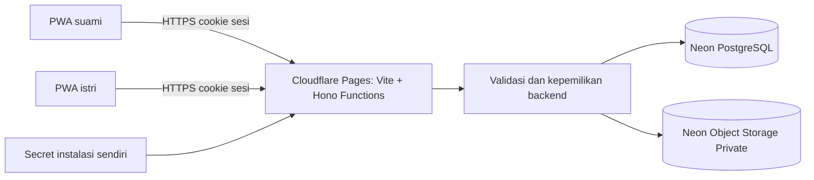

# Arsitektur Financée — Cloudflare Pages + Neon

## Kandidat Alokasi aktual — belum dirilis

Migrasi additive 0005 menambah metadata budget_items (recording_mode, posting_kind, posting_date, posting_version), metadata superseded pada expenses/transfers, klasifikasi default_items dan allocation_attachments. Semua baris lama tetap legacy. View effective_postings menjadi proyeksi PostgreSQL dari pos actual dan catatan manual yang belum digantikan; tidak menyimpan salinan transaksi otomatis. shared/ledger.ts memberikan proyeksi UI setara, jumlah aman dan pemisahan external/internal/reserve; laporan tahun melakukan preagregasi view agar join tidak menggandakan.

Tinjau/konversi melalui GET/PATCH /api/items/:id/posting, owner-only, CAS row_version dan revisi periode. Perubahan sumber dan penandaan anak terjadi dalam satu statement CTE/transaction dengan lock keluarga. Retry konversi yang sudah sama tidak menandai tambahan baru. Koreksi metadata mempertahankan identitas; histori yang digantikan tidak otomatis hidup setelah pembatalan. Guard histori mencegah penulisan ulang metadata lama. Nominal tetap pada endpoint edit kolom yang ada.

Koleksi bukti ketiga memakai pemetaan tabel/rute konstan /api/allocation-items/:id/attachments dan /api/allocation-attachments/:id/content. Hanya pos actual non-NULL aktif menerima bukti. Guard kuota/ID lintas tiga koleksi, checksum/decode, retire di pembatalan/hapus dan cleanup diperluas. Bukti expense lama tetap dapat dibaca sebagai arsip. API tidak membocorkan object_key.

Penulisan keuangan baru memerlukan X-Financee-Client: 2. API lama tanpa penanda ditolak 409 UPDATE_REQUIRED; login/logout/ganti sandi tetap kontraknya. Draf UI tidak diklaim tersimpan dan tidak dipaksa terhapus saat pembaruan PWA. Tidak mengubah auth, hash, sesi, provider, secret, framework atau menambah dependensi.

Kandidat gabungan memakai layanan dan dependensi yang sama. FinanceCharts dan YearDashboard merender diagram dengan CSS; shared/chart-data.ts mengelompokkan label alokasi identik, mempertahankan total, dan membedakan kosong dengan nol. Tiga kelompok terbesar serta kelompok sisa tampil pada donut. Diagram memiliki label/nominal dan rincian yang dapat dibaca tanpa mengandalkan warna. EvidenceGallery hanya memakai metadata ready dari snapshot bersesi; gambar tetap melalui proxy privat, dengan otorisasi backend.

Integrasi Neon disetujui sebagai pengganti D1/R2. UI, hitungan dan hak akses tidak berubah. Versi dasar dan paket visual/tahun/bukti pemasukan sudah dirilis; pembaruan terakhir diperiksa online pada 16 November 2026. Hasil aktual dan batas bukti ada di TESTING.md dan NEON_REVIEW.md.

## Komponen

Deployment kini memakai Pages advanced mode: build menghasilkan dist/_worker.js dari backend yang sama dan _routes.json untuk seluruh jalur. Berkas backend tidak masuk cache PWA dan tidak disajikan sebagai aset publik. Semua jalur tetap melewati header keamanan. Tidak menambah framework.

Satu keluarga memakai akun Cloudflare dan Neon sendiri. Tidak ada server pusat, registrasi bebas, layanan email, koneksi bank, analytics atau pelaksanaan transfer uang. Neon Auth, Functions, Realtime dan AI Gateway tidak diperlukan.

## Database dan transaksi

- Skema Drizzle memakai pg-core. Snapshot bulan memakai Drizzle neon-http; mutasi memakai query PostgreSQL terikat parameter melalui worker/db/postgres.ts. Placeholder $1, $2 dan sintaks PostgreSQL ditulis eksplisit; bukan emulasi SQLite.
- Neon HTTP transaction menjalankan advisory transaction lock keluarga 61324017 sebagai pernyataan pertama, sebelum data dibaca/ditulis, dalam READ COMMITTED. Adapter batch dan snapshot Drizzle mengikuti urutan sama. Ini menyerialkan dua penulis untuk kuota dan relasi serta menjaga snapshot tidak bercampur revisi. Tiap instalasi mempunyai database sendiri, sehingga lock ini tidak mengunci keluarga lain.
- Tidak ada koneksi WebSocket global atau transaksi interaktif pada Worker. Koneksi HTTP dibuat per request. Tidak mengulang otomatis transaksi yang jawabannya hilang karena commit mungkin sudah terjadi.
- Nominal dan waktu milidetik memakai BIGINT. Nilai kembali diparsing sebagai number aman; parser menolak integer di luar rentang aman JavaScript. Nominal dibatasi 1 triliun rupiah per pos/catatan. Posisi/versi memakai INTEGER.
- Constraint komposit mengikat pos, bulan dan pemilik. Trigger memeriksa relasi aktif, kuota dan revisi. Semua skrip pemeliharaan mengambil lock sebelum operasi; SQL manual harus mengikuti urutan sama agar tidak berbalik urutan lock baris.
- Pembuatan/salin bulan merupakan transaksi INSERT…SELECT; sumber tidak tersedia tidak membuat target kosong, target yang sudah ada tidak ditimpa. Hanya rencana pemilik disalin, tanpa realisasi/gambar.

## Autentikasi dan keamanan

- Tepat dua identitas partner-a/partner-b dari AUTH_USERS_JSON; hash aktif berada di account_credentials Neon. Provisioning menghasilkan sandi acak 24 byte dengan PBKDF2-SHA256 100.000 iterasi dan salt acak 16 byte untuk bootstrap. Sandi pilihan pengguna memakai HMAC-SHA384 di Worker dengan PASSWORD_PEPPER terpisah, base64 64 karakter, lalu pgcrypto bcrypt cost 12 di Neon. Database menerima hasil HMAC, bukan sandi mentah atau pepper. Tidak ada fallback ke hash bootstrap setelah perubahan.
- Cookie produksi __Host-ff_session: Secure, HttpOnly, SameSite=Strict, Path=/, tanpa Domain. PostgreSQL hanya menyimpan SHA-256 token, account ID, fingerprint HMAC dan kedaluwarsa tujuh hari. Logout mencabut sesi server; pergantian konfigurasi akun/SESSION_SECRET membatalkan sesi melalui fingerprint.
- Batas login atomik: lima percobaan per IP+identitas dan 30 per IP dalam 15 menit. Kunci HMAC, tanpa IP/email mentah. Respons akun tidak dikenal dan sandi salah sama.
- Setiap API kecuali login memerlukan sesi. Kedua akun membaca keluarga; hanya pemilik mengubah bagiannya. Owner dari input klien tidak dipercaya, termasuk pada retry dan referensi relasi. Kiriman masuk adalah turunan hanya baca.
- Mutasi memerlukan Origin tepat, tipe body benar, validasi Zod dan batas aktual 16 KiB untuk JSON. PUT gambar maksimal 5 MiB, JPG/PNG yang benar-benar didekode, batas dimensi/piksel/memori. Tidak ada endpoint upload workbook.
- Secret DATABASE_URL dan kredensial S3 hanya backend. Frontend menghubungi origin aplikasi sendiri. CSP aset lokal, nosniff, no-referrer, frame denial dan no-store berlaku pada API. Error tidak mengembalikan SQL atau konfigurasi. Observability default nonaktif; jangan mencatat sandi, token, nominal atau isi gambar.

## Kontrak API

Semua path di bawah /api. Semua endpoint selain POST /login memerlukan sesi valid. Respons kesalahan memakai {error:{code,message}}; 409 boleh menyertakan nilai terbaru untuk konflik pada data milik sesi. Snapshot bulan sekarang memuat dua bagian dan dashboard; GET boleh membaca pasangan, seluruh mutasi anggaran hanya pemilik.

| Metode dan path | Input / hasil |
| --- | --- |
| POST /login | email, password → cookie sesi dan nama tampilan |
| POST /account/password | Sesi aktif, sandi saat ini/baru/konfirmasi; hanya akun sendiri, cabut semua sesi akun tersebut |
| GET /me | Identitas tampilan akun aktif tanpa hash/kredensial |
| POST /logout | Cabut sesi; hapus cookie |
| GET /periods | Daftar ID bulan dan revision |
| POST /periods | id, mode, sourcePeriodId → buat periode bila belum ada dan anggaran milik sesi saja; salin hanya rencana pemilik |
| GET /periods/:id?revision=n | Snapshot konsisten; unchanged:true bila revisi sama |
| POST /periods/:id/items | id acak buatan klien, label, kind → baris baru nominal null |
| PATCH /items/:id | field: label atau amount, value, expectedVersion → nilai kanonik dan versi terbaru |
| DELETE /items/:id | expectedRowVersion → tombstone, bukan menghapus pos bulan lain |
| POST /expenses | id, date, itemId, note, amount → pengeluaran milik sesi |
| PATCH /expenses/:id | data lengkap, expectedVersion → ubah hanya pengeluaran sendiri |
| DELETE /expenses/:id | expectedVersion → hapus milik sendiri dan cabut akses bukti |
| POST /transfers | id, date, sourceItemId, amount → pengirim dari sesi, penerima pasangan otomatis |
| DELETE /transfers/:id | expectedVersion → hanya pengirim; tampilan kedua pihak diperbarui |
| POST /expenses/:id/attachments | id, contentType, byteSize, sha256 → reservasi slot upload milik sendiri |
| PUT /attachments/:id/content | bytes JPG/PNG → validasi dan simpan, tandai ready setelah konfirmasi |
| GET /attachments/:id/content | kedua akun dapat membaca ready jika pengeluaran induk aktif |
| DELETE /attachments/:id | pemilik pengeluaran saja; tandai deleting dan cabut akses sebelum hapus objek |

Kode: 400 input tidak valid; 401 sesi tidak valid/kedaluwarsa; 403 origin tidak diizinkan; 404 bulan/pos tidak ada; 409 versi berbeda atau bulan sudah ada; 413 body terlalu besar; 415 tipe body salah; 429 batas login; 500 kesalahan internal. Pos yang dihapus mengembalikan 409 ITEM_DELETED saat diedit. API tidak menerima total atau persentase dari klien.

## Draf, konflik dan sinkronisasi

React memisahkan snapshot dan draf per itemId+field. Maksimal satu request per kolom; jawaban terlambat tidak menandai draf baru tersimpan. CAS nama/nominal mempunyai versi terpisah, row_version untuk hapus. Expense/transfer mempunyai versi catatan. Retry nilai sama boleh berhasil tanpa menulis lagi; payload berbeda/ID tombstone ditolak. Konflik memerlukan keputusan pengguna sebelum mencoba versi baru.

Polling setiap 10 detik hanya saat tab terlihat dan online; berhenti saat sesi tidak aktif. Tidak menjanjikan realtime seketika. Tab terbuka dapat mempertahankan compute Neon aktif. Internal transfer tidak dihitung sebagai pemasukan/pengeluaran eksternal keluarga. Rumus domain tetap mengikuti workbook terverifikasi; tidak mengarang saldo rekening.

## Gambar privat dan kegagalan lintas layanan

Bucket evidence harus Private. Adapter S3 memakai aws4fetch SigV4, endpoint cabang, path-style dan region hasil CLI Neon (proyek Singapura yang diuji: ap-southeast-1). Kredensial storage scoped read/write cabang; tidak membuat URL publik/presigned. GET bukti selalu diproxy backend setelah sesi, status ready dan induk aktif diperiksa.

Reservasi ID tetap dengan checksum/ukuran, maksimal 10 pending/ready per pengeluaran. Key acak dibuat server, bukan nama asli. PUT memvalidasi isi, menulis storage lalu memfinalisasi PostgreSQL bila induk masih aktif. Jika jawaban hilang, ulangi ID/checksum sama. Bukti pending tidak dapat dibaca. Hapus mencabut metadata dahulu, lalu objek; deleting dipertahankan untuk pemeliharaan. Kegagalan SQL tidak membatalkan objek S3. Adapter tidak menambahkan retry tersembunyi.

## PWA dan data privat

Service worker hanya menyimpan shell, font dan aset; API, data keluarga, cookie dan gambar tidak masuk cache permanen. Draf hanya memori tab. Offline menampilkan kebutuhan koneksi dan menahan pengisian baru. Pembaruan menunggu antrean/isian aman dan persetujuan pengguna.

Workbook, template privat, .env*, .dev.vars, konfigurasi deployment nyata, akun, backup dan WORKLOG dikecualikan dari paket publik. Allowlist sumber diperiksa termasuk nilai rahasia lokal yang diketahui; ini bukan audit seluruh riwayat Git.

## Migrasi dan pemulihan

Migrasi SQL bernomor mempunyai registry SHA-256; file yang sudah diterapkan tidak boleh berubah. Tidak ada migrasi otomatis pada request pengguna. Tabel domain sembilan, ditambah registry schema_migrations.

Backup format 4 membaca sembilan tabel, termasuk account_credentials dan income_attachments, secara konsisten serta gambar siap dengan checksum. Sesi/percobaan login tidak diekspor. Restore hanya ke database/bucket terpisah, tujuan kosong dan versi migrasi sama. Seluruh nilai diperiksa kembali; reservasi belum siap menjadi deleting. Tidak ada transaksi tunggal PostgreSQL/S3 atau backup terjadwal. Lihat BACKUP.md. D1 lokal lama dipertahankan; tidak ada cutover data otomatis.

## Gerbang produksi

Cloudflare nyata masih harus membuktikan CPU hash/decode gambar, dua perangkat, instalasi PWA serta backup sebelum data keluarga digunakan. Local Worker + Neon nyata tidak sama dengan deployment produksi. Pemilik menyetujui rilis konkret setelah seluruh bahan siap.

## Pergantian sandi

POST /api/account/password menolak properti tambahan, meminta sandi lama dan origin sama, membatasi lima percobaan per akun per 15 menit. Sandi baru 15–128 Unicode code point, maksimal 512 byte UTF-8; spasi dipertahankan. Daftar sandi umum lokal bersifat terbatas, bukan layanan pemeriksaan kebocoran.

UPDATE hash memakai CAS versi dan sesi yang belum kedaluwarsa; pencabutan sesi akun sendiri berlangsung pada transaksi yang sama. DELETE terikat hash/versi hasil UPDATE agar request yang kalah tidak mencabut sesi baru. Login mengunci transaksi penyimpanan sesi dan memeriksa versi yang tadi diverifikasi. Fingerprint versi satu kompatibel dengan sesi lama; versi berikutnya terikat akun dan versi. Tabel sessions tetap lima kolom agar migrasi additive tidak merusak kode yang sedang berjalan. Pasangan tidak berubah.

Pepper harus disimpan privat di luar database, terpisah dari SESSION_SECRET. Jika hilang, hash bcrypt tidak bisa dipulihkan hanya dengan backup data. UI tidak mengulang otomatis permintaan setelah respons hilang dan hanya menyatakan berhasil bila balasan sukses terkonfirmasi.

## Laporan tahun — kandidat dashboard

GET /api/reports/year/:year memakai middleware sesi yang sama, tahun 2000–2100 divalidasi dan SQL berparameter. Satu statement mempragregasi budget_items, budgets dan expenses, lalu menggabungkan12 bulan. Tidak mengambil gambar, catatan/nama pos atau object_key. Tidak membaca transfers untuk perhitungan. Soft-delete dan jenis pos diperiksa. Dengan preagregasi, relasi tidak menggandakan total.

shared/year-report.ts menentukan kelengkapan, cakupan dan jumlah nominal. Total yang melebihi integer aman ditolak secara eksplisit; tidak dibulatkan. Saldo/rumus Excel lama tidak diubah. Tidak ada tabel, migrasi, layanan, secret atau dependensi baru. Frontend memakai grafik CSS ringan, label nilai, rincian yang dapat dipilih lewat keyboard dan scroll horizontal diHP.

Laporan dimuat ulang ketika revisi periode tahun itu atau snapshot aktif berubah, saat tahun dipilih, serta melalui tombol Muat ulang. Memakai polling periode aplikasi yang sudah ada tanpa timer kedua. Request lama dibatalkan ketika tahun/sesi berubah; respons rusak atau gagal tidak menampilkan angka lama sebagai hasil baru. API/keuangan tidak dicache oleh service worker. Keterangan kelengkapan menjelaskan pengecualian dan pembagi nol.

## Bukti pemasukan — kandidat migrasi 0004

income_attachments terpisah dari attachments pengeluaran agar induk dan constraint lama tetap utuh. Handler validasi gambar/storage/otorisasi digunakan bersama melalui pemetaan tabel/induk konstan; tidak mengambil identifier SQL dari input. POST /income-items/:id/attachments, PUT/GET /income-attachments/:id/content, DELETE /income-attachments/:id memakai autentikasi, Origin dan batas yang sama. Snapshot bulanan mengambil kedua koleksi dalam satu transaksi Drizzle dan menggabungkan metadata publik; key objek tidak dikirim ke frontend.

Trigger menjaga pemilik+kind income+induk aktif, kuota10pending/ready, serta ID unik lintas kedua koleksi di bawah advisory lock keluarga. Perubahan metadata menaikkan revisi bulan untuk sinkronisasi. Penghapusan pos menandai bukti deleting; download mengharuskan induk aktif. Cleanup meliputi kedua tabel. Tidak ada transaksi tunggal DB/storage; retry idempotent dan status pending/ready/deleting tetap dipakai. Tidak ada perubahan hitungan, provider, registrasi atau kredensial.

Backup format4 menambah tabel income_attachments dan objek siap dengan induk income aktif. Backup lama dipulihkan dengan kode yang cocok pada tujuan terisolasi, lalu diupgrade; jangan dipaksakan pada format baru. Rilis memerlukan backup format3 dengan kode lama sebelum migrasi, lalu backup format4 setelah rilis. Tidak mengubah sandi.
