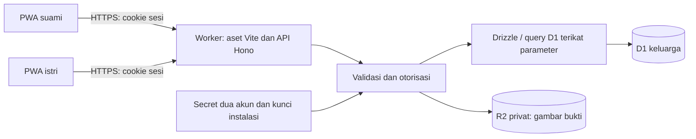

# Arsitektur — family-finance-pwa

Acuan tahap 5, revisi keluarga; implementasi lokal tahap 6 kini tersedia pada src/, shared/ dan worker/. Rincian di bawah tetap menjadi kontrak, bukan klaim seluruh kondisi produksi telah diuji. PRD.md dan REVISI_KELUARGA.md menetapkan hak akses per pemilik, realisasi, transfer internal dan bukti. Status pelaksanaan dan batas bukti ada di TESTING.md. Belum ada deployment produksi.

## Komponen

- Satu Worker per instalasi menyajikan aset statis dan /api pada origin yang sama. React + Vite + TypeScript, Tailwind CSS + shadcn/ui mengikuti desain tahap 4.
- Hono memvalidasi sesi pada semua API termasuk gambar. Pembacaan data keluarga diizinkan kedua akun; mutasi selalu memeriksa owner dari record pada server terhadap account_id sesi. owner dari body/URL tidak memberi kewenangan. Rencana/kiriman penerima adalah tampilan turunan yang hanya baca.
- D1 milik keluarga menjadi sumber kebenaran. Tidak ada backend pusat, websocket, Durable Objects, layanan email atau analitik eksternal pada MVP.
- MVP menggunakan D1 primary tanpa read replication. Query biasa tanpa Sessions API tetap menggunakan primary menurut dokumentasi [D1 read replication](https://developers.cloudflare.com/d1/best-practices/read-replication/). Ini menghindari rancangan replikasi tambahan pada penggunaan dua akun.

## Pembagian kode yang direncanakan

| Lokasi | Tanggung jawab |
| --- | --- |
| src/ | React, UI, draf per kolom, antrean simpan dan polling |
| shared/ | Tipe, validasi domain dan fungsi hitung murni yang sama untuk UI/API |
| worker/ | Hono, sesi, otorisasi, validasi, perubahan bersyarat |
| worker/db/ | Skema Drizzle dan query |
| migrations/ | SQL berurutan untuk skema dan indeks |
| scripts/ | Provisioning privat dua akun/template, backup dan pengujian pemeliharaan |
| data/ | Contoh fiktif saja |
| docs/ | Dokumen publik; pemetaan privat dikecualikan dari Git |

## Autentikasi dan sesi

- Tepat dua akun, dengan ID stabil partner-a dan partner-b. Identitas login, nama tampilan dan hash kredensial berada dalam secret AUTH_USERS_JSON; alamat pribadi tidak ditulis dalam kode atau D1.
- Provisioning membuat sandi acak 24 byte per akun menggunakan generator kriptografis, ditampilkan sekali untuk pemilik lalu disimpan dalam pengelola sandi. Tidak membuat endpoint registrasi, reset sandi email, atau perubahan sandi dalam aplikasi.
- Rancangan hash: PBKDF2-SHA256 100.000 iterasi, salt acak 16 byte, keluaran 32 byte. Profil ini khusus untuk sandi acak 192 bit yang dihasilkan provisioning; jangan menerima sandi lemah yang dipilih bebas. Nilai iterasi mengikuti batas runtime yang pernah teramati pada proyek lama, bukan jaminan dokumentasi runtime saat ini. Tahap implementasi wajib menguji hash di Worker nyata sebelum menerima data keluarga; kegagalan CPU/runtime menghalangi deployment, tidak ditangani dengan menurunkan kekuatan sandi.
- Fungsi kriptografi menggunakan API native dan perbandingan konstan waktu. Dukungan modul dijelaskan pada [Cloudflare crypto](https://developers.cloudflare.com/workers/runtime-apis/nodejs/crypto/); keberhasilan lokal saja tidak membuktikan perilaku Worker produksi.
- Login sukses membuat token acak 32 byte. Cookie __Host-ff_session menyimpan token mentah; D1 hanya menyimpan SHA-256 token, ID akun, masa kedaluwarsa tujuh hari dan fingerprint konfigurasi akun. Cookie HttpOnly, Secure, SameSite=Strict, Path=/, tanpa Domain.
- Setiap request membaca sesi aktif dari D1 dan memastikan ID akun masih ada dalam secret. Fingerprint HMAC dari konfigurasi autentikasi menggunakan SESSION_SECRET membuat perubahan konfigurasi akun atau kunci membatalkan sesi lama.
- Logout menghapus sesi pada server dan cookie. Cookie hilang saja tidak dianggap pencabutan sesi.
- Respons login untuk akun tidak dikenal dan sandi salah sama. Verifikasi dummy hash menjaga jalur verifikasi sebanding.
- Pembatasan login di D1 menggunakan hitungan atomik: 5 percobaan per kombinasi IP+identitas dalam 15 menit, serta 30 per IP dalam 15 menit untuk membatasi pergantian identitas. Slot percobaan dicatat dan batas diperiksa secara atomik sebelum verifikasi sandi agar request bersamaan tidak melewati batas. Kunci berupa HMAC, tanpa menyimpan IP/email mentah. Login sukses membersihkan hitungan identitas terkait tetapi tidak menghapus batas IP keseluruhan. Data kedaluwarsa dibersihkan berkala melalui penghapusan terbatas saat request login.

## Batas backend

- Validasi JSON dengan skema ketat; jenis, nominal, label, ID, bulan dan versi diverifikasi server. Klien tidak boleh memilih nama kolom SQL bebas.
- Mutasi memerlukan Origin sama dengan origin aplikasi, Content-Type application/json, serta sesi valid kecuali login. Tidak membuka CORS publik. Vite development memakai proxy sehingga origin browser tetap satu; pengecualian lokal tidak dibawa ke produksi.
- Body JSON dibatasi 16 KiB berdasarkan byte aktual; Content-Length hanya pemeriksaan awal. Pengecualian hanya endpoint bukti: PUT biner image/jpeg atau image/png maksimal 5 MiB, dengan autentikasi, Origin sama, kepemilikan, kuota lampiran dan validasi byte/struktur. Tidak menerima multipart umum atau endpoint unggah Excel.
- D1 hanya diakses Worker melalui binding; kredensial Cloudflare tidak dikirim ke browser. Prepared statements dan allowlist menghindari interpolasi SQL dari input.
- Terapkan CSP untuk aset lokal, frame-ancestors 'none', X-Content-Type-Options nosniff, Referrer-Policy no-referrer, dan Permissions-Policy yang menonaktifkan kamera, mikrofon serta geolokasi yang tidak digunakan.
- API memakai Cache-Control: no-store. Cookie, sandi, identitas login, nominal dan label tidak dicatat dalam log. Error internal hanya mengirim pesan umum dan ID request; diagnostik tidak boleh dipublikasikan sebagai endpoint.

## Kontrak API

Semua path di bawah /api. Semua endpoint selain POST /login memerlukan sesi valid. Respons kesalahan memakai {error:{code,message}}; 409 boleh menyertakan nilai terbaru untuk konflik pada data milik sesi. Snapshot bulan sekarang memuat dua bagian dan dashboard; GET boleh membaca pasangan, seluruh mutasi anggaran hanya pemilik.

| Metode dan path | Input / hasil |
| --- | --- |
| POST /login | email, password → cookie sesi dan nama tampilan |
| GET /me | Identitas tampilan akun aktif tanpa hash/kredensial |
| POST /logout | Cabut sesi; hapus cookie |
| GET /periods | Daftar ID bulan dan revision |
| POST /periods | id, mode, sourcePeriodId → buat periode bila belum ada dan anggaran milik sesi saja; salin hanya rencana pemilik |
| GET /periods/:id?revision=n | Snapshot konsisten; unchanged:true bila revisi sama |
| POST /periods/:id/items | id acak buatan klien, label, kind → baris baru nominal null |
| PATCH /items/:id | field: label atau amount, value, expectedVersion → nilai kanonik dan versi terbaru |
| DELETE /items/:id | expectedRowVersion → tombstone, bukan menghapus pos bulan lain |
| POST /expenses | id, date, itemId, note, amount → pengeluaran milik sesi |
| PATCH /expenses/:id | data lengkap, expectedVersion → ubah hanya pengeluaran sendiri |
| DELETE /expenses/:id | expectedVersion → hapus milik sendiri dan cabut akses bukti |
| POST /transfers | id, date, sourceItemId, amount → pengirim dari sesi, penerima pasangan otomatis |
| DELETE /transfers/:id | expectedVersion → hanya pengirim; tampilan kedua pihak diperbarui |
| POST /expenses/:id/attachments | id, contentType, byteSize, sha256 → reservasi slot upload milik sendiri |
| PUT /attachments/:id/content | bytes JPG/PNG → validasi dan simpan, tandai ready setelah konfirmasi |
| GET /attachments/:id/content | kedua akun dapat membaca ready jika pengeluaran induk aktif |
| DELETE /attachments/:id | pemilik pengeluaran saja; tandai deleting dan cabut akses sebelum hapus objek |

Kode: 400 input tidak valid; 401 sesi tidak valid/kedaluwarsa; 403 origin tidak diizinkan; 404 bulan/pos tidak ada; 409 versi berbeda atau bulan sudah ada; 413 body terlalu besar; 415 tipe body salah; 429 batas login; 500 kesalahan internal. Pos yang dihapus mengembalikan 409 ITEM_DELETED saat diedit. API tidak menerima total atau persentase dari klien.

## Draf dan antrean per kolom

- React memisahkan snapshot tersimpan dari draf. Identitas draf adalah itemId+field, bukan indeks baris atau label.
- Setiap antrean menyimpan baseVersion, desiredValue, generation, dan status. Maksimal satu request berjalan per kolom; perubahan berikutnya digabung menjadi nilai terbaru, bukan mengirim setiap ketukan.
- Respons hanya menyelesaikan generation yang dikirim. Respons lama tidak menandai draf baru sebagai tersimpan. Snapshot polling juga tidak mengganti draf.
- Server menjalankan perubahan compare-and-swap berdasarkan versi kolom. label dan amount memiliki versi terpisah; row_version naik pada keduanya untuk pemeriksaan hapus.
- Bila jawaban sukses hilang, ulangi isian yang sama. Jika nilai server sudah sama, server boleh menjawab sukses dengan versi saat ini tanpa menulis lagi. Jika nilainya berbeda dan versinya berubah, balas konflik. Jangan mengulang perubahan secara paksa dengan versi baru tanpa keputusan pengguna.
- Snapshot bulan memuat revision dan seluruh baris aktif dari satu snapshot DB, melalui satu query atau D1 batch konsisten. Respons snapshot yang lebih lama dari data yang sudah diterima diabaikan.
- Setelah mutasi, UI menggabungkan jawaban baris lalu memuat snapshot. Polling berjalan 10 detik saat tab terlihat; dihentikan saat offline atau sesi tidak aktif. Tidak membuat polling untuk setiap sel.

## Operasi utuh dan pengulangan request

- Buat/salin bulan menggunakan D1 batch: buat target hanya jika sumber valid, lalu seed dari template atau salin baris aktif langsung dengan INSERT…SELECT. Bukan mengambil daftar sumber ke browser lalu mengirim ulang. Semua berhasil atau seluruhnya dibatalkan; target yang sudah ada memicu konflik.
- Semantik batch dan rollback mengikuti [D1 Database API](https://developers.cloudflare.com/d1/worker-api/d1-database/#batch). Pemeriksaan source yang hilang harus menjadi bagian query bersyarat, bukan hanya SELECT awal yang bisa berubah sebelum mutasi.
- ID bulan unik mencegah duplikasi jika jawaban pembuatan bulan hilang. Klien yang menerima konflik memuat bulan yang sudah ada dan menampilkan bahwa bulan tersebut tersedia, tanpa menimpanya.
- ID pos dibuat klien satu kali per tindakan tambah dan dipertahankan saat retry. Jika ID sudah ada dengan bulan, jenis dan nama awal yang cocok, kembalikan baris sekarang. ID yang sudah dihapus atau payload berbeda memicu konflik; tidak menghidupkan kembali tombstone.
- Hapus memakai expectedRowVersion. Jika sudah dihapus, retry aman mengembalikan sukses; jika baris aktif berubah, kembalikan konflik dan tampilkan ulang data sebelum konfirmasi hapus berikutnya.

## Kepemilikan dan konsolidasi

- ID sesi partner-a dipetakan ke bagian suami, partner-b ke istri pada konfigurasi privat. Tidak mempercayai pilihan tampilan klien sebagai identitas.
- Pemilik melekat pada template, anggaran bulanan, pos, pengeluaran, kiriman dan bukti. Query mutasi mengikat ID record dan owner_id sesi sekaligus; kepemilikan relasi pos/expense/attachment juga diverifikasi agar ID pasangan tidak dapat dipasangkan ke record sendiri.
- Pos income dan allocation mewakili aliran eksternal. transfer_out adalah rencana kiriman ke pasangan; transfer_in diturunkan dari pos pengirim, bukan pos yang bisa diubah penerima.
- Pengeluaran nyata hanya mengacu pada allocation; transfer nyata mengacu pada transfer_out. Satu transfer menghasilkan dua sudut pandang tanpa dua catatan keuangan independen.
- Dashboard menggabungkan pemasukan dan alokasi eksternal, lalu merekap pengeluaran nyata. Jangan menjumlahkan pemasukan pribadi yang sudah termasuk kiriman masuk atau mengurangkan transfer sebagai belanja keluarga.
- Kepemilikan berbeda tidak menghilangkan kebutuhan CAS: dua perangkat milik akun sama tetap dapat berkonflik. Expense memakai version per catatan lengkap dan idempotency ID tetap.

## Bukti privat dan konsistensi D1–R2

- R2 Standard direncanakan sebagai penyimpanan biner lewat binding Worker, bukan bucket publik; D1 menyimpan metadata. Operasi get/put/delete Worker dirujuk pada [R2 Workers API](https://developers.cloudflare.com/r2/api/workers/workers-api-usage/).
- Reservasi slot gambar di D1 atomik, maksimal 10 attachment pending/ready per expense. ID dari klien tetap saat retry. Key R2 dibuat server dari ID acak; nama file tidak menjadi path atau URL publik. SHA-256 isi dan ukuran disimpan untuk idempotensi/checksum.
- Status pending → ready hanya setelah format/ukuran/dimensi valid dan R2.put berhasil. Siapkan parser struktur JPEG/PNG yang sesuai batas CPU/memori pada tahap 6; jangan mengandalkan ekstensi atau signature saja untuk menandai ready. Uji input rusak, polyglot dan decompression bomb sebelum produksi.
- D1 dan R2 bukan transaksi tunggal. Jika R2 berhasil tetapi metadata gagal, pending tetap tidak bisa dibaca; retry dengan ID/checksum sama mengonfirmasi ulang secara idempotent. Isi berbeda untuk ID sama ditolak.
- Finalisasi memeriksa expense masih aktif dan dimiliki akun saat upload dimulai. Jika expense terhapus di tengah upload, jangan menjadikan attachment ready; tandai cleanup dan hapus objek. Worker GET tetap memeriksa induk, status dan sesi pada setiap akses.
- Hapus terlebih dahulu mencabut akses di D1, kemudian menghapus objek R2. Jika objek gagal dihapus, status deleting dipertahankan untuk retry. Perintah pemeliharaan pemilik membersihkan pending kedaluwarsa dan objek yatim; tidak memakai cron/layanan tambahan pada MVP.
- Gambar dikirim dengan MIME yang telah diverifikasi, nosniff, Content-Disposition inline bernama aman dan Cache-Control private, no-store. CSP hanya mengizinkan gambar origin sendiri; blob: ditambahkan untuk preview file lokal, tanpa membuka endpoint publik.
- Jangan memasukkan data gambar ke polling 10 detik. Snapshot hanya metadata/ID; gambar diminta saat pratinjau dibuka atau thumbnail terlihat.
- Logout menutup viewer, membersihkan object URL/draf file dan memori data. Bukti tidak masuk service worker atau penyimpanan browser permanen.
- Produksi R2 memerlukan subscription; [panduan awal](https://developers.cloudflare.com/r2/get-started/) menyebut checkout dan [pricing](https://developers.cloudflare.com/r2/pricing/) memiliki free tier Standard dengan biaya bila terlampaui. Ini keputusan layanan pada tahap deployment; tidak mengaktifkan subscription atau menganggap biaya selalu nol dalam tahap desain.

## Template privat dan open-source

Template bawaan ada pada default_items tanpa nominal. Kode publik menyertakan template generik fiktif. Pemasangan keluarga ini menyiapkan nama sumber sekali dari berkas privat melalui CLI pemilik. Tidak ada pembacaan workbook otomatis saat aplikasi berjalan dan tidak ada endpoint unggah.

File workbook, pemetaan privat, prototype yang berisi nama privat, .env, .dev.vars, konfigurasi deployment aktual, secret payload, kredensial awal serta backup dikecualikan dari Git. Sebelum publikasi, periksa berkas tracked dan riwayat Git, bukan mengandalkan .gitignore saja.

## PWA, offline dan pembaruan

- Service worker hanya menyimpan shell statis, ikon, stylesheet dan bundle aplikasi yang tidak memuat template privat, foto bukti, atau data akun.
- Semua /api menggunakan network-only; tidak menyimpan respons data di Cache Storage, localStorage, sessionStorage atau IndexedDB. Data yang tampil dan draf hanya dalam memori tab.
- Shell offline menampilkan kebutuhan koneksi; tidak menampilkan tabel lama sebagai data terkini. Installability tidak berarti mendukung pengeditan offline.
- Versi baru menawarkan pembaruan setelah antrean simpan kosong. Tidak memakai reload paksa saat ada draf.
- Sinkronisasi dua perangkat hanya diuji setelah backend nyata dibuat; prototipe tahap 4 bukan bukti fitur ini.

## Migrasi, backup dan pemulihan

- Drizzle schema dan migrasi SQL berurutan ditinjau bersama; migrasi diterapkan lokal terlebih dahulu, lalu diuji ke data dummy. Tidak mengubah skema otomatis saat request pengguna.
- Sebelum migrasi produksi, ekspor SQL privat melalui Wrangler dan periksa target database. Panduan operasional menggunakan konfigurasi deployment yang diabaikan Git.
- Backup mencakup label, nominal serta tabel sesi; perlakukan sebagai rahasia dan simpan di lokasi pribadi. Tidak memasukkan backup ke repo atau URL publik.
- Pemulihan diuji pada D1 terpisah: impor backup, jalankan migrasi yang diperlukan, verifikasi jumlah data dan hitungan, lalu hapus semua sesi pulihan sebelum membuka akses. Cutover ke database pulihan memerlukan keputusan pemilik.
- Cloudflare menyediakan Time Travel; retensi dan batas paket diperiksa saat deployment, tidak dijanjikan sebagai satu-satunya backup. Rujukan: [Time Travel dan backup](https://developers.cloudflare.com/d1/reference/time-travel/).
- Tidak membuat backup terjadwal atau layanan penyimpanan tambahan pada MVP.

Revisi bukti: backup SQL saja tidak cukup. Pemilik membuat ekspor D1 beserta salinan objek R2 dan manifest key/checksum pada jendela tanpa mutasi/unggahan berjalan agar metadata dan gambar cocok. Restore diverifikasi pada D1 dan bucket terpisah, sesi dicabut, dan gambar yang hilang dilaporkan sebelum cutover. R2 untuk bukti adalah perluasan layanan yang kini masuk rancangan, bukan layanan backup terjadwal.

## Gerbang implementasi

Tahap 6 harus membuktikan CAS per kolom, trigger revisi, clone atomik, retry tanpa duplikasi, pencabutan sesi, pembatasan login, serta private-cache exclusion. Tahap 7–8 menguji perilaku penuh dan pengguna. Dukungan runtime, CPU autentikasi, instalasi PWA dan kuota layanan diperiksa sebelum deployment; dokumen ini tidak menyatakan hasil pengujian tersebut sudah lulus.
