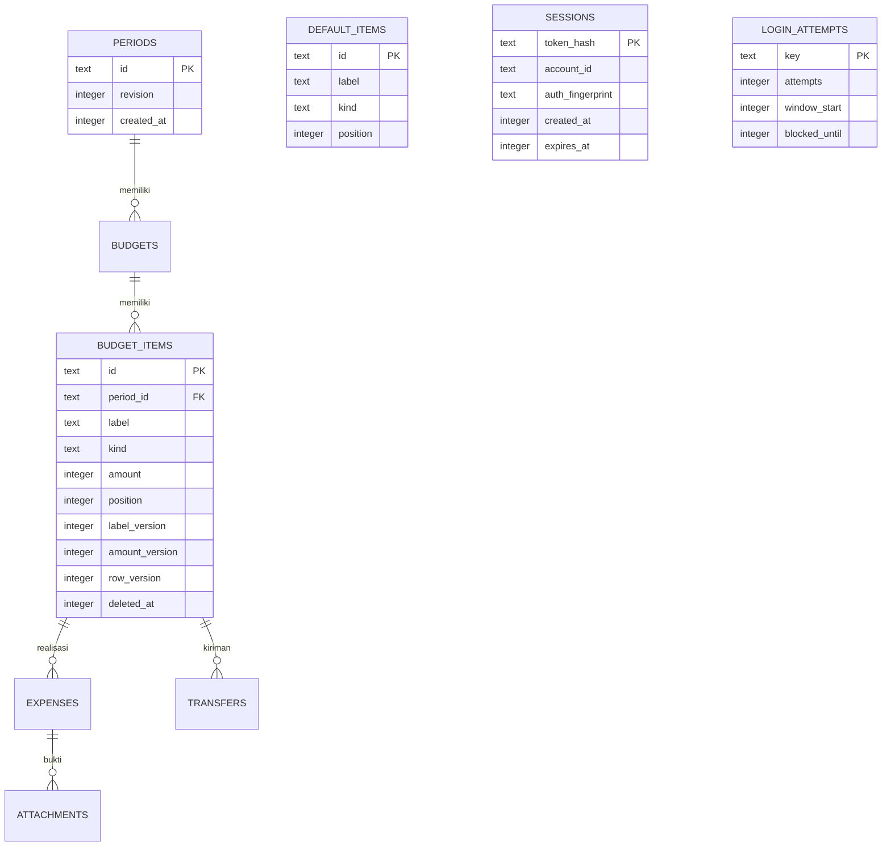

# Rancangan database PostgreSQL

## Kandidat migrasi 0006 — kelompok penyerahan

Empat tabel baru allocation_groups, allocation_group_items, allocation_group_operations dan group_attachments. Indeks unique partial menjaga satu keanggotaan aktif per pos. Guard memvalidasi owner/bulan, ID bukti lintas koleksi, kuota dan penulisan pos kelompok. Commit/cancel menyimpan seluruh anggota dalam transaksi yang sama, cutover mempertahankan histori, receipt tidak dapat diperbarui/dihapus. Grup/anggota yang dilepas tetap dapat dipulihkan sebagai histori. Jenis reserve tetap untuk tabungan sendiri dan data lama.

Tidak ada backfill kelompok berdasarkan label, perubahan akun atau konversi otomatis saat migrasi. Migrasi0001–0005 harus byte-identik. Skema Drizzle memetakan kolom kelompok yang dibaca API. Backup6 mencakup14tabel, selain sesi/login_attempts/schema_migrations sesuai kontrak backup.


## Migrasi 0005 — Alokasi aktual

budget_items: recording_mode legacy/actual (baris lama legacy); posting_kind external/internal/reserve; posting_date nullable dan valid dalam bulan; posting_version positif. Actual non-income bernominal terisi wajib memiliki jenis. Jenis template privat lama tidak ditebak dari label; pemilik memilih sebelum mengisi pos actual baru. Income mempertahankan perilaku awal.

expenses/transfers: superseded_by_item_id dan superseded_at harus sama-sama NULL atau terisi, mengacu sumber dan owner/periode yang benar; histori yang sudah ditandai tidak dapat diedit. allocation_attachments mengikuti kontrak metadata gambar koleksi lama dengan allocation_item_id sebagai induk. effective_postings adalah VIEW, tidak ikut sebagai tabel backup; format 5 memuat sepuluh tabel keuangan/kredensial/bukti, bukan sessions/login_attempts. Migrasi 0001–0004 tidak diubah; fungsi family_guard baru mempertahankan perbaikan tombstone dari 0002.


Integrasi Neon menggantikan D1/SQLite. Sembilan tabel aplikasi awal tetap, ditambah account_credentials, income_attachments dan schema_migrations untuk nomor/hash migrasi. Skema Drizzle pg-core dan SQL bernomor adalah sumber implementasi; data keluarga lokal lama tidak dipindahkan otomatis. Nominal/waktu memakai BIGINT, versi/posisi INTEGER. Semua transaksi mengambil advisory lock keluarga sebelum query data dalam READ COMMITTED; snapshot dan kuota konsisten untuk dua penulis. Hasil serta batas pengujian pada TESTING.md.

## Konvensi

- Satu database untuk satu keluarga. Tidak ada household_id karena tidak ada multi-tenant atau server pusat.
- ID pos adalah 128 bit acak dalam 32 karakter heksadesimal lowercase. ID bulan YYYY-MM.
- Waktu BIGINT berupa Unix epoch milidetik UTC dari server. Bulan adalah identitas kalender yang dipilih pengguna, tidak dikonversi dari UTC.
- Nominal disimpan BIGINT rupiah positif menurut jenis. NULL berarti belum diisi. Tidak menggunakan REAL untuk uang.
- Versi dan revisi INTEGER dimulai dari 1, monoton naik, tidak memakai timestamp untuk menentukan konflik.
- Foreign key aktif; bulan sumber tidak menjadi foreign key karena salinan berdiri sendiri.



## default_items

| Kolom | Tipe | Aturan |
| --- | --- | --- |
| id | TEXT PRIMARY KEY | ID stabil template; tidak bergantung pada label |
| owner_id | TEXT NOT NULL | partner-a atau partner-b; template per pemilik |
| label | TEXT NOT NULL | Trim, 1–100 karakter |
| kind | TEXT NOT NULL | income, allocation atau transfer_out |
| position | INTEGER NOT NULL | Urutan dalam kelompok, ≥ 0 |

Tidak menyimpan nominal atau email akun. owner_id adalah ID tetap internal. Pengguna aplikasi tidak memiliki endpoint mutasi template. CLI pemilik melakukan provisioning privat satu kali; seed publik memakai data fiktif, termasuk label istri generik yang bukan dari workbook. Tidak menimpa template privat saat deployment kode berikutnya.

## periods

| Kolom | Tipe | Aturan |
| --- | --- | --- |
| id | TEXT PRIMARY KEY | YYYY-MM, tahun 2000–2100 dan bulan 01–12 |
| revision | INTEGER NOT NULL DEFAULT 1 | ≥ 1, naik pada perubahan anggaran, pengeluaran, kiriman dan metadata bukti bulan tersebut |
| created_at | BIGINT NOT NULL | Waktu pembuatan server |

Tidak menyimpan total, sisa, persentase atau ketergantungan ke bulan sumber. Daftar bulan diurutkan berdasarkan id, sehingga urutan kalender konsisten.

## budgets

| Kolom | Tipe | Aturan |
| --- | --- | --- |
| period_id | TEXT NOT NULL REFERENCES periods(id) | Identitas bulan bersama |
| owner_id | TEXT NOT NULL | partner-a atau partner-b |
| created_at | BIGINT NOT NULL | Waktu server |

PRIMARY KEY(period_id, owner_id). Satu anggaran per pemilik per bulan. Baris tidak dibuat otomatis oleh pasangan. Hanya berfungsi sebagai kepala anggaran; tidak berisi total atau nominal. Pembuatan periode memakai INSERT jika belum ada, lalu membuat budgets milik sesi secara atomik. Bila periode telah ada dari pasangan, tambahkan hanya budgets pemilik sesi; anggaran pasangan tidak diubah.

## budget_items

| Kolom | Tipe | Aturan |
| --- | --- | --- |
| id | TEXT PRIMARY KEY | ID acak stabil, tidak digunakan ulang setelah hapus |
| period_id | TEXT NOT NULL | Bagian foreign key komposit ke budgets |
| owner_id | TEXT NOT NULL | Bagian foreign key komposit ke budgets; dari sesi, tidak dapat diubah |
| label | TEXT NOT NULL | Trim, 1–100 karakter |
| kind | TEXT NOT NULL | income, allocation atau transfer_out; tetap setelah dibuat |
| amount | BIGINT NULL | NULL atau integer 0–1.000.000.000.000 |
| position | INTEGER NOT NULL | ≥ 0; urutan dalam kelompok |
| label_version | INTEGER NOT NULL DEFAULT 1 | ≥ 1, naik hanya saat label berubah |
| amount_version | INTEGER NOT NULL DEFAULT 1 | ≥ 1, naik hanya saat nominal berubah |
| row_version | INTEGER NOT NULL DEFAULT 1 | ≥ 1, naik saat label, nominal, atau status hapus berubah |
| created_at | BIGINT NOT NULL | Waktu server |
| updated_at | BIGINT NOT NULL | Waktu server mutasi terakhir |
| deleted_at | BIGINT NULL | Tombstone; NULL berarti aktif |

FOREIGN KEY(period_id,owner_id) REFERENCES budgets(period_id,owner_id) ON DELETE RESTRICT. UNIQUE(id,period_id,owner_id) untuk relasi anak yang memverifikasi pemilik/bulan. Indeks (period_id,owner_id,deleted_at,kind,position,id). Mutasi mengikat owner_id sesi; GET keluarga boleh membaca kedua bagian. Urutan per kelompok position lalu id; label tidak menjadi identitas.

Constraint SQL memeriksa panjang label, tipe integer nominal, batas nominal, jenis yang valid, serta versi positif. Backend memeriksa ID/bulan/payload. Batas 200 pos aktif per pemilik per bulan ditegakkan atomik. Pos yang memiliki expense atau transfer aktif ditolak saat dihapus. incoming transfer rencana dihitung dari transfer_out milik pasangan; tidak menyimpan baris pemasukan kedua.

Pos baru diberi position = MAX(position kelompok)+1 dalam query insert yang sama; tidak menghitung di klien. ID client yang dipertahankan saat retry mencegah duplikasi.

Tombstone tidak ditampilkan atau dihitung. Disimpan pada MVP untuk membedakan edit terlambat ke pos yang dihapus dari pos baru dan mencegah penggunaan ulang ID. Tidak menyediakan UI riwayat atau pemulihan pos.

## Compare-and-swap per kolom

Contoh query rancangan untuk nominal (seluruh nilai menggunakan parameter terikat):

```sql
UPDATE budget_items
SET amount = ?, amount_version = amount_version + 1,
    row_version = row_version + 1, updated_at = ?
WHERE id = ? AND owner_id = ? AND deleted_at IS NULL AND amount_version = ?
RETURNING id, amount, amount_version, row_version;
```

- Label memakai pola yang sama dengan label_version.
- Jika nilai yang diminta sudah sama dengan nilai server, respons boleh sukses tanpa menulis atau menaikkan versi. Gunakan perbandingan yang membedakan NULL dan 0.
- Jika tidak ada baris terubah, baca keadaan saat ini: tidak ada → 404; tombstone → 409 ITEM_DELETED; versi berbeda dan nilai berbeda → 409 FIELD_CONFLICT.
- Balasan mencakup versi baris dan kedua versi kolom, agar UI dapat menggabungkan data dengan benar. Server tidak menerima row_version buatan klien sebagai nilai baru.
- Hapus memakai ID, owner_id sesi, deleted_at IS NULL serta row_version yang sesuai; cek tidak ada referensi aktif, lalu isi deleted_at dan naikkan row_version. Retry ke tombstone milik sendiri aman. Tombstone pihak lain tetap tidak boleh dimutasi.
- Trigger setelah insert dan update menaikkan periods.revision pada period_id terkait dalam transaksi yang sama. Update tanpa perubahan nilai tidak dipanggil untuk menghindari revisi palsu. Label/amount version diubah oleh query mutasi, bukan trigger kedua yang berpotensi menghitung dua kali.

## sessions

| Kolom | Tipe | Aturan |
| --- | --- | --- |
| token_hash | TEXT PRIMARY KEY | SHA-256 token sesi; token mentah tidak disimpan |
| account_id | TEXT NOT NULL | partner-a atau partner-b; masih harus ada dalam konfigurasi secret |
| auth_fingerprint | TEXT NOT NULL | HMAC konfigurasi autentikasi; versi >1 diturunkan lagi dengan account_id dan versi kredensial, bukan salinan hash sandi |
| created_at | BIGINT NOT NULL | Waktu login server |
| expires_at | BIGINT NOT NULL | created_at + tujuh hari; tidak diperpanjang setiap polling |

Indeks expires_at untuk pembersihan. Setiap request memeriksa kedaluwarsa dan fingerprint. Logout menghapus token_hash terkait. Pembersihan sesi kedaluwarsa bersifat terbatas dan oportunistik agar tidak perlu cron atau layanan tambahan. Restore database mencabut seluruh sesi sebelum digunakan.

## login_attempts

| Kolom | Tipe | Aturan |
| --- | --- | --- |
| key | TEXT PRIMARY KEY | HMAC namespace+IP atau namespace+IP+identitas login |
| attempts | INTEGER NOT NULL | ≥ 0; upsert mencatat slot percobaan dan memeriksa batas secara atomik sebelum hash diverifikasi |
| window_start | BIGINT NOT NULL | Awal jendela server |
| blocked_until | BIGINT NOT NULL | 0 atau waktu akhir blok |

Indeks blocked_until/window_start untuk pembersihan terbatas. Tidak menyimpan email, IP mentah, sandi, atau token sesi. Kebijakan blok mengacu ARCHITECTURE.md.

## Buat dan salin bulan

1. Periksa skema input dan keberadaan konfigurasi template.
2. Dalam satu batch transaksi: pastikan periode target, buat budgets milik sesi yang belum ada, lalu INSERT…SELECT template atau pos sumber milik sesi dengan ID baru. Salinan versi dimulai dari 1; nominal NULL tetap NULL. Pengeluaran, transfer nyata dan attachments tidak disalin.
3. Query pembuatan target dari sumber harus bergantung pada keberadaan sumber dalam transaksi. Jika sumber tidak ada, jangan membuat target kosong secara tidak sengaja.
4. Duplikasi anggaran (period_id,owner_id) menyebabkan rollback. Periode yang sudah ada dari pasangan boleh dipakai untuk anggaran sendiri tanpa menimpa pasangan. Kegagalan insert satu pos membatalkan seluruh pembuatan anggaran, termasuk periode baru bila dibuat pada batch itu.
5. Snapshot sumber milik sesi berasal dari SQL dalam transaksi itu. Perubahan sebelumnya ikut tersalin; perubahan sesudahnya tidak mengubah salinan. Salinan transfer_out hanya membentuk rencana kiriman masuk turunan, tidak membuat atau mengubah budgets pasangan.
6. Ambil snapshot target hanya setelah transaksi sukses. Jangan menampilkan pesan bulan dibuat sebelum konfirmasi server.

## Migrasi dan verifikasi yang direncanakan

- Migrasi awal rancangan baru membuat sembilan tabel, constraint, indeks dan trigger; belum ada database produksi yang perlu dimigrasikan dari lima tabel lama. Definisi Drizzle dan SQL harus konsisten.
- Seed template publik dan provisioning privat dipisahkan dari migrasi skema; tidak memuat nama keluarga atau nominal workbook.
- Uji constraint dan CAS dua penulis pada PostgreSQL lokal; uji rollback dengan kegagalan insert yang disengaja; uji revision untuk insert/edit/hapus; uji pengulangan request.
- Uji salin terhadap NULL, nol, nama duplikat, pos terhapus, dua pembuatan bulan bersamaan, dan edit sumber saat salin.
- Uji backup/restore ke database terpisah, verifikasi constraint dan trigger ikut pulih, serta hapus sesi pulihan.
- Semua ini adalah gerbang tahap implementasi/pengujian; belum dijalankan dalam tahap 5.

## expenses

| Kolom | Tipe | Aturan |
| --- | --- | --- |
| id | TEXT PRIMARY KEY | ID tetap dibuat klien, retry tidak membuat catatan baru |
| period_id, owner_id | TEXT NOT NULL | Bulan dan pemilik; hanya pemilik dapat menulis |
| item_id | TEXT NOT NULL | FK komposit (item_id,period_id,owner_id) ke budget_items; kind wajib allocation dan pos aktif |
| occurred_on | TEXT NOT NULL | Tanggal kalender valid YYYY-MM-DD dalam period_id |
| note | TEXT NOT NULL | Trim 1–150 karakter |
| amount | BIGINT NOT NULL | 1–1.000.000.000.000 rupiah |
| version | INTEGER NOT NULL DEFAULT 1 | CAS seluruh catatan saat edit/hapus |
| created_at, updated_at | BIGINT NOT NULL | Waktu server |
| deleted_at | BIGINT NULL | Hapus logis, dikeluarkan dari ringkasan dan akses bukti |

Indeks (period_id,owner_id,deleted_at,occurred_on,id) dan item_id. Maksimal 1.000 pengeluaran aktif per pemilik per bulan; batas dijaga atomik. Dengan dua pemilik, batas nominal dan jumlah ini menjaga agregasi bulanan dalam rentang integer aman JavaScript. Backend dan constraint/trigger memeriksa pemilik/jenis pos, bukan hanya keberadaan ID.

## transfers

| Kolom | Tipe | Aturan |
| --- | --- | --- |
| id | TEXT PRIMARY KEY | ID tetap untuk retry |
| period_id | TEXT NOT NULL | Bulan kiriman |
| from_owner_id | TEXT NOT NULL | Dari akun sesi; hanya pengirim dapat menghapus |
| to_owner_id | TEXT NOT NULL | Pasangan yang berbeda, ditentukan server |
| source_item_id | TEXT NOT NULL | FK komposit ke pos transfer_out milik pengirim pada bulan sama |
| occurred_on | TEXT NOT NULL | Tanggal valid pada period_id |
| amount | BIGINT NOT NULL | Rupiah positif sesuai batas nominal |
| version | INTEGER NOT NULL DEFAULT 1 | Untuk penghapusan aman |
| created_at | BIGINT NOT NULL | Waktu server |
| deleted_at | BIGINT NULL | Catatan dihapus dari kedua tampilan |

Indeks period_id/from_owner_id/deleted_at, period_id/to_owner_id/deleted_at, dan source_item_id. Maksimal 1.000 kiriman aktif per pengirim per bulan. Rencana kiriman disimpan dalam budget_items.transfer_out; transfers hanya realisasi. Tidak mengubah amount rencana dan tidak membuat expense/pemasukan eksternal.

## attachments

| Kolom | Tipe | Aturan |
| --- | --- | --- |
| id | TEXT PRIMARY KEY | ID tetap untuk reservasi/retry |
| expense_id | TEXT NOT NULL REFERENCES expenses(id) | Induk aktif saat reservasi/finalisasi |
| owner_id | TEXT NOT NULL | Harus sama dengan expenses.owner_id; tidak dapat diubah |
| object_key | TEXT NOT NULL UNIQUE | Key Neon Object Storage acak dibuat server; bukan nama asli |
| content_type | TEXT NOT NULL | image/jpeg atau image/png yang diverifikasi |
| byte_size | INTEGER NOT NULL | 1–5.242.880; byte aktual harus sesuai |
| sha256 | TEXT NOT NULL | Checksum isi; ID sama tidak boleh berganti isi |
| width, height | INTEGER NULL | Diisi setelah validasi struktur; batas sisi 10.000 dan 16 megapiksel |
| status | TEXT NOT NULL | pending, ready, deleting atau failed |
| created_at, updated_at | BIGINT NOT NULL | Waktu server untuk retry/cleanup |

Indeks (expense_id,status), (status,updated_at). Maksimal 10 slot pending/ready per pengeluaran dijaga atomik saat reservasi; slot gagal/kedaluwarsa dibersihkan sebelum penggantian. GET hanya ready dengan expense aktif, kedua sesi boleh membaca. DELETE/PUT hanya pemilik expense. Nama tampilan gambar ditentukan server seperti bukti-01.jpg, sehingga tidak perlu menyimpan nama berkas pribadi mentah di log atau object key.

Constraint/trigger menaikkan revision periode induk untuk perubahan expense, transfer dan attachment yang mengubah tampilan. Perubahan status bukti memengaruhi count dashboard, bukan jumlah rupiah. PostgreSQL menandai pending/deleting untuk pemulihan operasi lintas Neon Object Storage; jangan menyatakan batch PostgreSQL turut membatalkan objek Neon Object Storage.

## Pengujian revisi keluarga

- Percobaan mutasi ID pos/expense/transfer/attachment milik pasangan ditolak, termasuk memasangkan expense sendiri dengan item pasangan.
- Cek pembatasan pemilik tetap berlaku sebelum jalur retry/idempotensi; retry bukan celah otorisasi.
- Perhitungan konsolidasi memakai external income/allocation dan expense aktif, tidak seluruh income turunan pribadi.
- Uji concurrent upload untuk slot ke-10, hapus induk saat upload, kegagalan Neon Object Storage.put, kegagalan finalisasi PostgreSQL, objek yatim, serta pembacaan bukti induk terhapus.
- Uji restore gabungan manifest objek Neon Object Storage dan ekspor PostgreSQL; backup SQL saja tidak dianggap memulihkan bukti.

## Kredensial akun — migrasi 0003

account_credentials memiliki account_id (PK partner-a/partner-b), scheme, hash, salt, iterations, pepper_id, version positif dan updated_at. Constraint memisahkan legacy_pbkdf2 (hex hash/salt, iterasi 100.000) dari bcrypt_hmac_sha384 (bcrypt cost12, pepper_id SHA-256 dari secret; salt/iterations NULL). pgcrypto dipasang eksplisit pada public. Tidak menyimpan sandi mentah atau pepper.

accounts:init memindahkan dua hash bootstrap dengan INSERT ON CONFLICT DO NOTHING; menjalankannya ulang tidak mengembalikan sandi yang sudah diganti. Migrasi tidak mengubah sessions yang sudah ada. Versi sesi diikat dalam auth_fingerprint; versi satu mempertahankan sesi lama saat upgrade. CAS kredensial dan DELETE sesi hanya milik akun yang berhasil diubah dilakukan atomik.

## Migrasi 0004: income_attachments

Kolom id, income_item_id FK budget_items, owner_id, object_key, content_type, byte_size, sha256, width/height, status dan created_at/updated_at. Constraint format/ukuran/dimensi/status mengikuti attachments. Guard trigger memeriksa income aktif milik pemilik yang sama dan kuota10. ID bukti tidak dapat sama dengan ID pada tabel attachments; trigger kedua sisi mengunci transaksi keluarga. Trigger revisi menaikkan periods.revision, trigger retire menandai bukti deleting saat pos dihapus. Tabel/record pengeluaran dan kredensial yang sudah ada tidak dimigrasi ulang.
